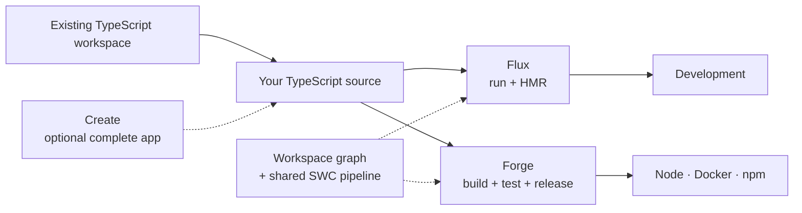

# Decohere

A productivity-first TypeScript API framework and toolchain.

[](https://github.com/typesmiths/decohere/actions/workflows/ci.yml?query=branch%3Amain)
[](https://github.com/typesmiths/decohere/actions/workflows/ci.yml?query=branch%3Arelease)
[](https://github.com/typesmiths/decohere/actions/workflows/ci.yml?query=branch%3Arelease)

## The problem

Starting a TypeScript project is still a research exercise. Before writing anything useful you have to pick a module format, reconcile `tsconfig.json` with the runtime you actually run on, and choose a compiler, a test runner, and a dev loop. None of those choices answer the questions that matter: where source belongs, how a package directory is laid out, what shape npm expects when you publish, and how the development setup stays consistent with what ships.

If all you want is to run a script, none of that should be your problem. Getting a TypeScript file to execute should not cost an afternoon—least of all for someone new to TypeScript and Node.

Decohere aims to cover that whole range—from running a single file to creating, debugging, and shipping a complete Node API in minutes—with one toolchain and one set of conventions. Run a file today; the same tools build, test, version, containerize, and publish it later, without swapping pipelines or relitigating the layout.

## What it is

The **framework** handles the cross-cutting concerns an API needs: HTTP and routing, dependency injection, configuration, structured logging, authentication and authorization, data access, and health checks. The [scaffolder](projects/create/README.md) currently wires those into a working app with Fastify, Pino, Postgres/TypeORM, Auth0, Postman, a Dev Container, production Dockerfiles, and CI.

Those vendors are defaults, not the framework contract. Decohere is provider-oriented, with support for more HTTP, logging, auth, data, and other providers planned. The goal is to manage vendor lock-in by keeping vendor-specific code at composition boundaries, so changing a provider does not require rewriting the application.

The **toolchain** handles the development lifecycle. **[Forge](projects/forge/README.md)** understands the workspace package graph and owns build, typecheck, version, publish, and Docker workflows; its Vitest plugin compiles test sources through the same pipeline. **[Flux](projects/flux/README.md)** runs those TypeScript sources directly and restarts the application when they change. Both use source-aware workspace resolution and Forge's SWC compiler, so development and release do not become two unrelated pipelines.

You do not need to scaffold an app or adopt the framework to use Forge or Flux. Add the [CLI](projects/cli/) to an existing TypeScript workspace and use either tool on its own.

## Why Decohere?

Node already has excellent frameworks and build tools. The setup cost is not caused by any one of them being weak; it comes from nothing owning how they fit together. That is why the problem does not go away once the project is running—it reappears as the same class of decision at every step: adding a package, wiring a cross-cutting concern, keeping the development loop honest about production, and maintaining the glue in between.

Decohere treats that as one product. The framework supplies an opinionated API architecture; the toolchain gives development, testing, and release the same workspace graph and compiler pipeline. The intended result is less boilerplate and tinkering before the first endpoint, and less drift between “works locally” and what is shipped.

## How it differs

- **Compared with [NestJS](https://docs.nestjs.com/):** Nest primarily defines an application model—modules, controllers, and providers—with CLI build and monorepo support. Decohere extends that scope across the workspace lifecycle: the package graph, compiler, tests, development runtime, release output, and API framework are designed together. [Forge](projects/forge/README.md) and [Flux](projects/flux/README.md) remain usable without the framework.
- **Compared with [Nx](https://nx.dev/docs/getting-started/intro):** Decohere is a direct competitor in the workspace-tooling space, with an API-first scope. Nx is broader and currently offers features such as general task orchestration and distributed caching that Decohere does not. Decohere's focus is the tightly integrated path from TypeScript source to a running and released Node API.
- **Developer loop:** fast boot in large workspaces and rapid HMR are product goals, not incidental tooling details. Decohere resolves packages directly to source, without prebuilding every dependency, and does not block emit or boot on a whole-workspace typecheck. [Flux](projects/flux/README.md) reloads the app in-process and disposes the previous boot cleanly. Executable [tests](docs/testing/) establish that the program works; typechecking validates the static contract before it ships. Work is ongoing to drive startup toward near-zero framework and tooling overhead.

### Example: from an empty directory to a deployable API

For a one-off script, install the CLI and run the TypeScript file directly:

```bash
pnpm init
pnpm add -D @decohere/cli
pnpm exec flux run report.ts
```

There is no module-format decision, build step, framework, or scaffold in that path.

When the outcome is a production API instead, start there:

```bash
pnpm create @decohere webapi -d orders
cd orders
pnpm dev
```

That creates more than a controller skeleton. The result has a working package and source layout, configuration and environment conventions, structured logging, health and readiness routes, test setup, linting and typechecking, local HMR, CI, a production build, and Dockerfiles. The scaffolder can also wire Postgres/TypeORM, Auth0, and Postman while it creates the app.

Saving a source file reloads the affected API through [Flux](projects/flux/README.md), including changes in workspace libraries, without prebuilding every dependency. `pnpm build` uses the same compiler pipeline through [Forge](projects/forge/README.md) to emit the production layout consumed by `pnpm start` and the generated Dockerfile.

The acceleration is not one generated file. It is avoiding a separate round of tool selection, layout design, configuration, and integration at every step between the first TypeScript file and a deployable service.

## Getting started



Install the CLI to make `forge`, `flux`, and `decohere` available to package scripts and `pnpm exec`:

```bash
pnpm add -D @decohere/cli
```

The [recipes and use cases](docs/recipes/) start at the smallest useful outcome. If you only want to execute a TypeScript file, that is the first recipe and it needs no scaffold, no build step, and no `tsconfig.json` decisions. Publishing a package to npm is the next one. Scaffolding a full API is further down the same path, not a different product.

## Forge

Workspace-aware build and release workflows using [`@decohere/workspace`](projects/workspace/README.md) and SWC. Debug resolves workspace imports to source; release emits the production package shape. Forge also provides typecheck, Vitest, version, publish, Docker, and link workflows.

```bash
pnpm exec forge build
pnpm exec forge build --configuration release
```

Commands and build model: [`@decohere/forge`](projects/forge/README.md).

## Flux

Run TypeScript directly through Forge's compiler—one file with `run`, or a long-lived Node app with `serve` and HMR. No pre-build or Decohere framework required.

```bash
pnpm exec flux run src/main.ts
pnpm exec flux serve
```

Commands and runtime model: [`@decohere/flux`](projects/flux/README.md).

## Scaffold an API

Scaffolding is the optional path to a complete Decohere app. It combines the framework and toolchain, then walks you through database, auth, Postman, and install. The result includes health checks, a Dev Container, production Dockerfiles, and CI. Docker is required to run the scaffolder.

```bash
pnpm create @decohere webapi -d my-app
```

```bash
cd my-app
code .
pnpm build
pnpm dev
```

Options and generated app: [`@decohere/create`](projects/create/README.md).

## Docs

Handbook: **[docs/](docs/)** — architecture, style, testing, contributing, CI, ADRs.

## License

[ISC](LICENSE) © Typesmiths
