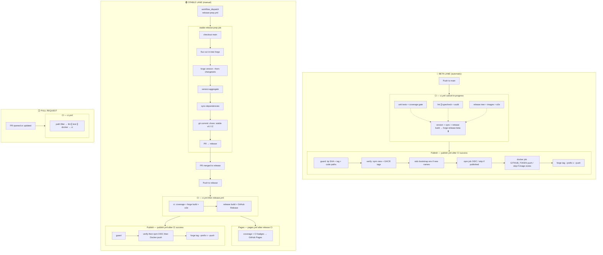

# CI and release

Two automated lanes: **beta** (every push to `main`) and **stable** (manually triggered).

Workflow files live under `.github/workflows/`. This page is the human map.

## Workflow files

| Path | Role |
|---|---|
| `.github/workflows/ci.yml` | `changes` → parallel `lint` ∥ `test` ∥ `docker` (one forge release: `forge publish --dry-run`, pack, `forge docker --dry-run` with `create:local`, scaffold e2e; no npm upload / GHCR push) → aggregate `ci` (required check). Feature: units + scaffold Docker e2e. `main`: coverage **gate** + scaffold Docker e2e + beta prep. `release`: coverage artifact + full e2e + stable `release.yml`. Docs/meta path short-circuit. Lint gates **high/critical** `pnpm audit`. |
| `.github/workflows/npm-audit.yml` | Nightly (`0 6 * * *` UTC) + `workflow_dispatch`: `pnpm audit`, log/summary with advisory **severity**, opens or updates the GitHub issue `security(ci): npm audit vulnerabilities detected`. Not a merge gate. |
| `.github/ci/code-paths-filter.yml` | Shared globs: which paths count as “code” for CI / publish |
| `.github/workflows/pages.yml` | Coverage and CI status badges → GitHub Pages (**after successful `release` CI only**); carries the benchmark history over unchanged |
| `.github/workflows/bench.yml` | Nightly (`17 3 * * *` UTC) + `workflow_dispatch` on `main`: benchmarks tonight's commit against the previous nightly's on the same runner (`nightly.mjs`), saves, then redeploys Pages with the trend charts ([Benchmarks](#benchmarks)). Report only, not a merge gate. |
| `.github/workflows/clear-benchmark-history.yml` | Manual, on `main`: republishes Pages with an empty benchmark history |
| `.github/actions/setup-node-pnpm` | Shared composite: pnpm + Node + auth + install |
| `.github/workflows/publish.yml` | After successful CI on tip of `main` / `release`: npm + Docker + create smoke, then `v*` tag (tip / already-shipped tag / docs-only via parent→head path filter) |
| `.github/workflows/release-prep.yml` | Manual stable release-prep PR into `release` |
| `.github/workflows/release.yml` | Reusable stable build + GitHub Release |

## Lane summary

| | Beta | Stable | Pull request |
|---|---|---|---|
| Trigger | push to `main` | `workflow_dispatch` → PR → push to `release` | a pull request opened or updated, from this repo or a fork |
| Version source | latest git tag (no commit) | `.changeset` entries (commit to prep branch); dormant until the first public release ([ADR 0003](../adr/0003-no-changesets-until-public-release.md)) | n/a (dry-run) |
| npm tag | `dev` | `latest` | n/a |
| Git tag pushed | ✅ `v1.x.y-dev.N` (after smoke) | ✅ `v1.Y.Z` (after smoke) | ❌ |
| PR created | ❌ | ✅ `release/stable-main-to-release → release` | ❌ |

A pull request's run, a fork's included, has no secrets and a read-only token, and the suite needs neither. Publish and Pages start from CI's `workflow_run`, which pull requests trigger too, so both check that the run came from a **push** to this repository, not just from a branch called `main` or `release`: a fork can name its branch anything. A branch without a pull request gets no CI; open a draft PR to run it.

## Publish order (`publish.yml`)

After CI succeeds on tip of `main` / `release` (and the tip-SHA + code-path guard passes):

1. **verify** — version bump (local only) + `npm view` + GHCR tag probe. Outputs skip-npm / skip-docker / unpublished names. No `packages: write`.
2. **oidc-bootstrap** — only if unpublished names; waits on `npm-oidc-bootstrap` reviewers. Job title lists names; **View deployment** opens the GitHub issue (commands in the body).
3. **npm** — `environment: npm-publish`, OIDC `npm publish` (or skip if versions exist).
4. **docker** — the only job with `packages: write`; logs in to GHCR with the job's own `GITHUB_TOKEN` (or skips if images exist), smoke.
5. **tag** — `forge tag --prefix v --push`

A `v*` tag means the tip SHA **fully shipped**. Failed smoke (or any earlier step) leaves no new tag, so a re-run of Publish for the same tip SHA is allowed. The guard still skips when a `v*` tag already points at that SHA (duplicate successful publish).

## Pipeline Diagram



\* Suite runs when the change matches [`.github/ci/code-paths-filter.yml`](../../.github/ci/code-paths-filter.yml) (or on `release` / `workflow_dispatch`). Otherwise CI exits success after the filter (docs/meta only) — no `[skip ci]` token. Pull request: parallel **lint** (oxlint + Prettier ∥ tsc + audit) ∥ **test** (units) ∥ **docker** (one forge release: npm publish `--dry-run`, pack `create.tgz`, `forge docker --dry-run` tagging `create:local`, scaffold e2e). Dry-run means build-without-push, not skip-build. `main`: coverage **gates** thresholds + scaffold Docker e2e (no Pages refresh). `release`: coverage upload + full e2e + stable release; Pages badges refresh from `release` only; benchmarks refresh nightly from `main`. Publish refuses docs-only SHAs.

## Benchmarks

Results: <https://typesmiths.github.io/decohere/benchmark.html> (raw data in `data/bench-history.json`). `bench.yml` runs every suite nightly on `main` and appends the run to the history; each benchmark gets a chart of its median over time, one line per machine type.

| Suite | Benchmarks | Measures |
|---|---|---|
| `flux-serve` | `flux.serve.start`, `flux.serve.reload-root`, `flux.serve.reload-leaf` | Real `flux serve` process: spawn until the app is ready (CLI from source, so it includes compiling flux itself), and save until the rebooted app is ready, for a file everything imports and one only its barrel imports. Debounce 0. |
| `flux-load` | `flux.load.cold`, `flux.load.cold-cached`, `flux.load.warm`, `flux.load.cold.*` | The load hook compiling and importing the app in process: what a user's app pays at startup, without the CLI. Cold is a fresh process and warm is a second import, as after a save, both with the disk cache off. Cold-cached is a fresh process whose disk cache an earlier run filled, as when an app restarts with nothing changed. The cold load is also split into SWC, resolving imports, the rest of the load hook, and Node linking and evaluating. |
| `flux-transpile` | `flux.transpile.*` | SWC alone and warm, with flux's options: one file at a time with inline, separate or no source maps, and all files in parallel. For comparing strategies; a real cold start pays more (`flux.load.cold.swc`). |
| `forge-build` | `forge.build.*` | `forge build` of the cli e2e fixtures, per configuration. |

The flux suites generate a workspace of 8 libraries × 40 files (`BENCH_LIBS`, `BENCH_FILES`). Locally:

```bash
pnpm bench                       # every suite, compared with your last saved run
pnpm bench flux-serve flux-load  # some suites
pnpm bench:save                  # also append to projects/ci-tools/dist/ci/bench/bench-history.json
```

Runs are grouped by machine (platform, CPU model and cores, memory, Node version) and only compared within one. GitHub's shared runners vary from night to night, so read the trend rather than one point, and measure a change locally before and after with `pnpm bench`.

Every benchmark takes the same number of samples, `BENCH_SAMPLES` (default 10): one per process for the process benchmarks, one per round for the in-process ones. Each machine type keeps its last 30 runs.

**When a benchmark gets slower:** each night, `nightly.mjs` benchmarks tonight's commit and the commit the previous nightly measured, on the same runner, alternating them for 2 rounds. GitHub's runners vary in CPU model from night to night, so this keeps every comparison on one machine. If a benchmark's median is more than 20% slower on tonight's commit in both rounds, the job opens an issue titled `perf(bench): <id> is slower` with both rounds' numbers, the commit range and how to reproduce, or updates the open issue with that title. The next night compares against the slow commit, so the issue stays open until someone fixes the cause or closes it with a reason. Rule: `REGRESSION` in [`history.mjs`](../../projects/ci-tools/src/bench/history.mjs). Machine types with no run in 30 days are dropped from the history and the page.

## Nightly npm audit

[`.github/workflows/npm-audit.yml`](../../.github/workflows/npm-audit.yml) runs `pnpm audit` every day at 06:00 UTC (`workflow_dispatch` also). It prints each advisory (severity, GHSA, path) to the job log and GitHub step summary, then opens or updates the GitHub issue `security(ci): npm audit vulnerabilities detected` (the same issue `main` CI updates, edited in place rather than commented on). High/critical findings **do not** fail the nightly job; PR/`main` CI (`ci.yml` lint/typecheck) remains the merge gate.

## Published Packages

Current `@decohere/*` packages under `projects/` (Vitest plugin is `@decohere/forge/vitest`, not a separate package):

- `@decohere/forge`
- `@decohere/flux`
- `@decohere/cli`
- `@decohere/workspace`
- `@decohere/core`
- `@decohere/devkit`
- `@decohere/testing`
- `@decohere/crucible`
- `@decohere/http`
- `@decohere/config`
- `@decohere/data`
- `@decohere/data-typeorm`
- `@decohere/scribe`
- `@decohere/scribe-pino`
- `@decohere/scribe-console`
- `@decohere/create`
- `@decohere/scaffold`
- `@decohere/ci-tools`

Retired npm names (`nexus`, `cortex`, `protocol`, `codex`, `mesh`, `terminal`, `anvil`, `hearth`, `forge-vitest`, …) must not appear in new docs. The retired-names table in [docs/architecture](../architecture/README.md#appendix--retired-names) maps them.

## Building from source

The repo installs no published `@decohere/*` package. `tools/register.mjs` runs the repo's own TypeScript from source (`pnpm forge …`, `pnpm flux …`), and the Vitest configs load the `forgeBuild` plugin from source too. A fresh clone installs without an npm token, a bad publish can't break CI, and deprecating or unpublishing an npm name doesn't affect this repo.

## New Package Bootstrap (OIDC pause)

npm cannot attach a trusted publisher until the package **name** exists. Publish **verify** checks `npm view` of each non-private workspace package **name**. If any are missing, the **oidc-bootstrap** job runs on GitHub environment `npm-oidc-bootstrap` (deployment branches `main` / `release`). Required reviewers on that environment pause only this job (it is skipped when every name already exists). Do **not** put reviewers on `npm-publish` (that would pause every release).

While it waits, the job title lists the missing names and **View deployment** opens the GitHub issue `deploy(publish): OIDC bootstrap unpublished packages` (opened or updated by verify, and reopened if it was closed). Its body has the exact `npm publish` / Trusted Publisher / Approve commands. It is assigned to the `npm-oidc-bootstrap` environment's required reviewers. The waiting job has not started yet, so there is no GitHub step summary until after you approve.

Steps 1 and 2 are one command. From the **repo root**, after `npm login` to the org:

```bash
pnpm npm:bootstrap --otp <code> @decohere/scribe-console   # or no names: every name not on npm yet
```

[`npm-bootstrap.mjs`](../../projects/ci-tools/src/github/npm-bootstrap.mjs) first-publishes each name public, then runs `npm trust github` with the settings below. It skips a step that is already done. npm runs on your terminal and does its own 2FA: it asks for a code, or for the browser login, whenever it needs one, so `--otp` is optional and an expired code (they last about 30 seconds) just makes npm ask again. `npm trust` takes no `--otp` flag, so the script hands the code over as `NPM_CONFIG_OTP`. `--dry-run` prints the npm commands without running them. By hand:

1. First-publish the package **public** from the **repo root** (`--access public`: scoped names default to restricted). Use `./projects/<dir>` so npm does not treat the path as a GitHub `owner/repo`. Prerelease versions (`x.y.z-dev.N`) need `--tag dev`. A stable `x.y.z` can omit `--tag`. Missing `bin`/`es6` is OK; this only creates the name. Example: `npm publish ./projects/scaffold --access public --tag dev`.
2. npm → package settings → Trusted Publisher → GitHub Actions:
      - Organization: `typesmiths`
      - Repository: `decohere`
      - Workflow filename: `publish.yml`
      - Environment: `npm-publish`
      - Allowed action: `npm publish` (not staged-only)
3. Approve the waiting deployment. The job then re-checks that the names exist; **npm** (OIDC) + **docker** + **tag** continue in the same run. If reviewers were not configured and the job already failed, `gh run rerun --failed` instead.

Retries of an untagged tip skip npm and/or Docker independently when that version is already on the registry / GHCR.

## Registry credentials

CI stores no registry credential. npm packages are public, so reads (`npm view`, `npx @decohere/create`) need no token, and `npm publish` goes through Trusted Publishing (OIDC) from the `npm-publish` environment. A workflow that writes an npm token into `.npmrc` fails the ci-tools tests.

Docker images need no stored credential either. Publish's `docker` job logs in to GHCR with its own `GITHUB_TOKEN` and is the only job in any workflow that asks for `packages: write`; it runs only after CI passes on a push to `main` or `release`. Fork pull requests and Dependabot get a read-only token. GHCR accepts the token only for images whose **Manage Actions access** gives this repository the **Write** role (set once per image, under the package's settings). Anyone who could change the workflow to push from another branch already has write access to the repo.

Repo **Actions default GITHUB_TOKEN is read**. Callers of reusable workflows must grant any write the callee requests (e.g. `ci.yml` → `release.yml` needs `permissions: contents: write` on that job). A job that omits `permissions` no longer gets write.

## Emergency Manual Release

> Only use when CI is unavailable or compromised.

**Prerequisites:** `npm login` as a member of the `@decohere` npm org with publish access.

```bash
git checkout main && git pull
npm run forge:release:dry            # Validate first
npm run forge:release -- --preid dev --no-tag --log-level trace
git push -u origin HEAD
gh release create v<version> --generate-notes --title "v<version>"
```
