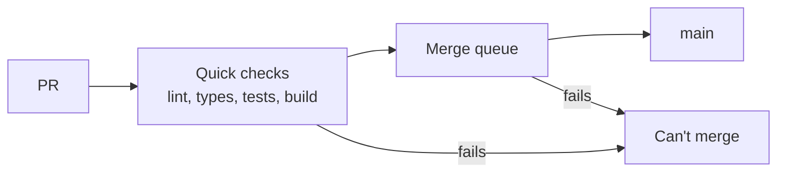
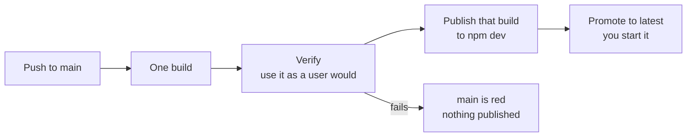

# CI and release

CI stores no secrets or variables. npm publishing uses Trusted Publishing (OIDC) from the `npm-publish` environment, GHCR pushes use the workflow's own `GITHUB_TOKEN`, and the packages are public on npm, so reading them needs no token. A ci-tools test fails if any file under `.github/` mentions `NODE_AUTH_TOKEN` or `_authToken`.

## What runs when

| Event | What runs |
|---|---|
| Pull request (this repo or a fork) | CI: lint, typecheck, unit tests, release build and publish dry run. Images are built only when their files change, and Docker-backed tests run only when data code changes. Read-only token, no secrets. |
| Merge queue (`merge_group`) | The same checks on the PR combined with `main` and the PRs ahead of it, docs-only or not. No images or Docker-backed tests: `main` covers those. |
| Push to `main` | The integration run. A beta release build, then **verify-release** uses it from a temporary registry, alongside the coverage gate and Docker-backed tests. Lint, typecheck and the package check don't repeat, because the queue tested this same commit. If it all passes, Publish uploads that build to the npm `dev` dist-tag. |
| Push to `release` | CI with coverage, full e2e and a GitHub Release, then, in parallel, Publish to the npm `latest` dist-tag and Pages (badges). |
| Nightly 03:17 UTC | Bench on `main`, then Pages (benchmark charts). |
| Nightly 06:00 UTC | npm audit. |

`main` accepts changes only through the merge queue, with squash merges, and requires the `ci` check. A branch without a pull request gets no CI; open a draft PR. Docs-only changes (nothing matching [`code-paths-filter.yml`](../../.github/ci/code-paths-filter.yml)) skip the suite on pull requests and `main` pushes, and the `ci` check still passes. `release`, `workflow_dispatch` and the merge queue never skip for docs. An image break can land on `main` when a PR didn't touch the image files: `main` turns red and nothing publishes until it's fixed.

## The flows

A pull request:



A push to `main`:



## Workflow files

| File | Role |
|---|---|
| [`ci.yml`](../../.github/workflows/ci.yml) | The suite; required check `ci`. Calls `release.yml` on `release`. |
| [`promote-latest.yml`](../../.github/workflows/promote-latest.yml) | Started by hand: moves npm `latest` to a version that fully shipped. |
| [`publish.yml`](../../.github/workflows/publish.yml) | After CI succeeds on `main`/`release`: npm, Docker images, smoke test, `v*` tag. |
| [`pages.yml`](../../.github/workflows/pages.yml) | After CI succeeds on `release`: coverage and CI badges to GitHub Pages. |
| [`bench.yml`](../../.github/workflows/bench.yml) | Nightly benchmarks on `main`, deployed to Pages. |
| [`clear-benchmark-history.yml`](../../.github/workflows/clear-benchmark-history.yml) | Manual: redeploys Pages with an empty benchmark history. |
| [`npm-audit.yml`](../../.github/workflows/npm-audit.yml) | Nightly `pnpm audit` report. |
| [`release-prep.yml`](../../.github/workflows/release-prep.yml) | Manual: versions from changesets and opens a PR into `release`. |
| [`release.yml`](../../.github/workflows/release.yml) | Reusable: stable release build and GitHub Release. |
| [`setup-node-pnpm`](../../.github/actions/setup-node-pnpm/action.yml) | Composite action: pnpm, Node, install, optional git identity. |
| [`publish-prepare`](../../.github/actions/publish-prepare/action.yml) | Composite action: applies the dev version and downloads CI's release build for Publish. |
| [`code-paths-filter.yml`](../../.github/ci/code-paths-filter.yml) | Which paths count as code for CI and Publish. |

## CI (`ci.yml`)

`changes` decides whether to run the suite; these jobs run and `ci` fails if any that ran didn't pass:

- **lint/typecheck**: `lint:check`, `typecheck`, actionlint, a check for packages not on npm yet, and `pnpm audit`, which fails on high or critical advisories. On `main` pushes it also updates the `security(ci): npm audit vulnerabilities detected` issue.
- **test (1/2, 2/2)**: unit tests split across two jobs, on everything except `main` and `release`.
- **coverage** (`main` and `release`): the unit tests with coverage thresholds. On `release` it uploads coverage for Pages.
- **test-docker**: Docker-backed tests. On `main`, `release` and manual runs, and on a PR that changes data code.
- **build** (`main` and manual runs): stamps the dev version, syncs dependency versions and uploads the release build as `forge-release-beta-<run>`.
- **package** (everything except `main`): one release build, dependency drift report, a generated app typechecked against that build ([`generated-app-types.e2e.spec.ts`](../../projects/scaffold/e2e/generated-app-types.e2e.spec.ts)) and `forge publish --dry-run`. When the image files changed, or on `release`, it also packs `create.tgz` and runs `forge docker --dry-run` (images built, not pushed). On `release` it runs the full e2e suite too.
- **verify-release** (`main` and manual runs only): takes `build`'s build, runs the quick e2e specs for the build and the forge CLI, publishes it to a temporary registry ([Verdaccio](../../.github/ci/verdaccio.yaml)) inside the job, builds the images, then runs [`real-install.e2e.spec.ts`](../../projects/create/e2e/real-install.e2e.spec.ts): the real launcher, the generated app's install, typecheck, build, test, lint and `/health` on exact pnpm versions, the generated Dev Container, with and without Postgres, and the install steps in the docs. If it fails, nothing reaches npm. A broken merge turns `main` red, and publishing stops until a fix or revert lands ([ADR 0020](../adr/0020-test-the-real-install-before-publishing.md)).

To run it on a branch without publishing: `gh workflow run ci.yml --ref <branch>`. Publish only follows pushes.

On `release`, the `release` job then calls `release.yml`, which builds the stable release tree and creates the GitHub Release.

## Publish (`publish.yml`)

Runs when CI succeeds on a **push** to this repository's `main` or `release`; pull request runs and forks are excluded.

CI chooses a dev version once, before its release build: `0.0.1-dev.20261104.512` is the commit's UTC date and CI's run number. Publish reads that version from the build and never works it out again ([ADR 0019](../adr/0019-dev-versions-from-the-ci-run.md)).

1. **guard**: skips docs-only commits, commits that are no longer the branch tip, and commits that already have a `v*` tag.
2. **verify**: probes npm and GHCR for this version and outputs which steps to skip. It fails if a package name isn't on npm yet, which the merge queue should already have stopped.
3. **npm**: `forge publish --channel dev` from `main`, `--channel latest` from `release`, over OIDC. Skipped if the version is already on npm.
4. **docker**: the only job with `packages: write`. Builds and pushes the `create` and `devcontainer` images (plus `:latest` from `release`), then runs `npx @decohere/create@<version> --help`, first waiting for npm to serve the new version.
5. **tag**: `forge tag --prefix v --push`.

A `v*` tag means that commit fully shipped. If any step fails there is no tag, so re-running Publish is safe: npm and Docker each skip what is already published.

GHCR accepts the `GITHUB_TOKEN` only for images whose **Manage Actions access** gives this repository the **Write** role (set once per image). The default `GITHUB_TOKEN` is read-only: jobs declare their own `permissions`, and a caller of a reusable workflow grants what the callee needs.

## Stable release

Changesets stay off until the first public release ([ADR 0003](../adr/0003-no-changesets-until-public-release.md)), so this lane is dormant. When used:

1. Run **Release Prep** (`release-prep.yml`, optional `dry_run`). It computes the version from changesets, syncs dependency versions, commits `chore(release): stable <version>` and opens a PR into `release`.
2. Merge the PR. The push to `release` runs CI, `release.yml`, Publish (npm `latest`) and Pages.

## Pages

GitHub Pages (<https://typesmiths.github.io/decohere/>) holds the badges and benchmark charts. `pages.yml` (after CI on `release`), `bench.yml` and `clear-benchmark-history.yml` each deploy the whole site and share one concurrency group. Each carries over what it does not regenerate: the coverage badge exists only after a `release` CI run.

## Benchmarks

Results: <https://typesmiths.github.io/decohere/benchmark.html>. Report only, never a merge gate.

Suites: `flux-serve` (a real `flux serve` process: start, and reboot after a save), `flux-load` (compiling and importing an app in process, cold and warm), `flux-transpile` (SWC alone), `flux-run` (`flux run` of a one-line script on the installed CLI, since running from source always loads the TypeScript compiler; it builds into `dist/release`) and `forge-build` (the cli e2e fixtures, per configuration).

```bash
pnpm bench                       # every suite, compared with your last saved run
pnpm bench flux-serve flux-load  # some suites
pnpm bench:save                  # also append to projects/ci-tools/dist/ci/bench/bench-history.json
```

`BENCH_SAMPLES` (default 10) sets samples per benchmark. Runs are compared only within one machine type, which keeps its last 30 runs. Shared runners vary, so read the trend and measure a change locally.

Each night [`nightly.mjs`](../../projects/ci-tools/src/bench/nightly.mjs) runs tonight's commit and the previous nightly's on the same runner, 2 rounds each. A benchmark more than 20% slower in both rounds opens or updates the issue `perf(bench): <id> is slower`.

## npm audit

`npm-audit.yml` runs `pnpm audit` daily at 06:00 UTC and opens or updates the `security(ci): npm audit vulnerabilities detected` issue. It never fails on findings; the merge gate is the audit step in CI.

## Published packages

All under `projects/`, all public on npm: `@decohere/` `core`, `http`, `config`, `data`, `data-typeorm`, `workspace`, `devkit`, `testing`, `crucible`, `scribe`, `scribe-pino`, `scribe-console`, `forge`, `flux`, `cli`, `create`, `scaffold`, `ci-tools`. The Vitest plugin is `@decohere/forge/vitest`. `devcontainer` is private and ships only as an image.

The repo installs no published `@decohere/*` package (`tools/register.mjs` runs everything from source), so a bad publish cannot break CI.

## Adding a new npm package

npm can attach a Trusted Publisher only to a name that exists, and creating a name needs an owner's npm login, so CI can't do it. Contributors need no npm access: on their PR, **lint/typecheck** leaves a notice naming the package and stays green. In the merge queue, the same check fails until the name exists.

When the PR is ready to merge:

1. From the repo root, after `npm login` to the org:

   ```bash
   pnpm npm:bootstrap --otp <code> @decohere/<name>   # no names: every name not on npm yet
   ```

   [`npm-bootstrap.mjs`](../../projects/ci-tools/src/github/npm-bootstrap.mjs) first-publishes each name public and runs `npm trust github` for it, skipping what is done. `--otp` is optional (npm asks when needed); `--dry-run` prints the commands.

2. By hand instead: `npm publish ./projects/<dir> --access public --tag dev` (drop `--tag` for a stable version), then on npm: package settings, Trusted Publisher, GitHub Actions, with organization `typesmiths`, repository `decohere`, workflow `publish.yml`, environment `npm-publish`, allowed action `npm publish`.
3. Add the PR to the merge queue. Doing this only when it's ready avoids leaving an unused name on npm if the PR is abandoned.

## Promote to latest

[`promote-latest.yml`](../../.github/workflows/promote-latest.yml) moves `latest` to a version already on `dev`, with no login or OTP. Start it from the Actions tab, or:

```bash
gh workflow run promote-latest.yml                       # what dev points at
gh workflow run promote-latest.yml -f version=<version>
```

It stops with nothing moved if any package lacks the version, or the version has no `v*` tag, which means it didn't fully ship. It also stops if the version is under a day old, because current pnpm skips versions that new and would install an older one; `-f allow_young=true` overrides that. Run it again if it stops partway: packages already there are skipped.

**Setup, once.** Each package needs a Trusted Publisher for this workflow, separate from its `publish.yml` one, and `npm trust` has no flag for its permission.

1. On npmjs.com, in the settings of `@decohere/cli`, add a Trusted Publisher: GitHub Actions, organization `typesmiths`, repository `decohere`, workflow `promote-latest.yml`, no environment. Under Allowed actions, turn **Allow npm publish** off and **Allow npm dist-tag** on.
2. Copy it to every other package with one OTP code. This uses npm's undocumented registry endpoint, and only adds entries:

   ```bash
   NPM_TOKEN="$(sed -n 's#^//registry.npmjs.org/:_authToken=##p' ~/.npmrc)" \
     pnpm npm:trust-promote --otp <code>
   ```

3. Run the workflow within 2 days: npm's docs say a new publisher must complete a successful publish in that time.

A new package needs step 2 again: `pnpm npm:bootstrap` prints a reminder.

## Changing npm by hand

When the workflow can't do it, changes on npm run from an owner's machine, on the owner's npm login.

- **Log in through the browser.** `npm whoami` shows whether you're logged in; if not, run `npm login`. The owner does this; agents don't.
- **Use one OTP code, not access tokens.** Every npm write needs 2FA. With `--otp=<code>` npm uses the code; without it, npm asks you to log in again in the browser for each package. Agents ask the owner for a code and never ask them to create a token.
- **Run all the packages in one command.** A code expires in about 30 seconds, so go in parallel, not one by one.

To point `latest` at a version on every package without the workflow:

```bash
VERSION=<version>   # must already be on npm for every package; check the dev tag
read -rp "OTP code: " OTP
printf '%s\n' core http config data data-typeorm workspace devkit testing crucible scribe scribe-pino scribe-console forge flux cli create scaffold ci-tools |
  xargs -P 18 -I{} npm dist-tag add "@decohere/{}@$VERSION" latest --otp="$OTP"
```

If some fail because the code expired, run it again with a new code; repeating a package that already moved does no harm. A `+latest: ...` line means that package moved. `npm view` can show the old tag for a minute or so afterwards, so don't take that as a failure or retry because of it; `npm dist-tag add` warning `already set` confirms the move. Then check with `npm view @decohere/<name> dist-tags`.

## Emergency manual release

Only when CI is unavailable. Needs `npm login` as a member of the `@decohere` org. Publishes npm packages only, no images.

```bash
git checkout main && git pull --tags
pnpm install
pnpm forge version --channel dev --build-number 1000000   # above any CI run that day; add one for a second release
pnpm forge dependencies --configuration release sync
pnpm forge build --configuration release
pnpm forge publish --channel dev --dry-run
pnpm forge publish --channel dev --prompt-otp
pnpm forge tag --prefix v --push
```
