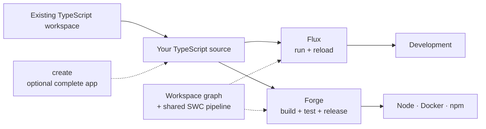

# Getting started

Two starting points: run a TypeScript file, or scaffold a whole API. Both use the same tools.

## Run a TypeScript file

```bash
npm init -y && npm pkg set type=module
npm i -D @decohere/cli
npx flux run report.ts
```

No build step, `tsconfig.json` or framework. [Flux](../projects/flux/README.md) compiles with Forge's SWC pipeline as Node loads each file.

## Scaffold an API

Needs Docker: the scaffolder runs in a container. Scaffolded projects use pnpm.

```bash
pnpm create @decohere webapi -d orders
cd orders
pnpm dev
```

You get a working app with config and environment conventions, structured logging, health and readiness routes, tests, lint and typecheck, reload on save, CI, a production build and Dockerfiles, plus a Dev Container. The scaffolder can also wire Postgres/TypeORM and Auth0. Options: [`@decohere/create`](../projects/create/README.md).

Saving a file reloads the API through Flux, including changes in workspace libraries, without prebuilding them. `pnpm build` runs the same compiler through Forge and emits what `pnpm start` and the Dockerfile run.

## The tools



`npm i -D @decohere/cli` gives package scripts and `npx` the `forge`, `flux` and `decohere` commands. Use them in an existing workspace without the framework.

- **[Flux](../projects/flux/README.md)** runs TypeScript from source: one file with `flux run`, or a long-running app with `flux serve`, reloading on save.
- **[Forge](../projects/forge/README.md)** builds, typechecks, tests, versions, publishes and builds Docker images, workspace-aware: `forge build` resolves workspace imports to source; `forge build --configuration release` emits the published package shape.

## Using pnpm

To add the CLI with pnpm instead of npm:

```bash
pnpm add -D @decohere/cli --allow-build=@swc/core
pnpm exec flux run report.ts
```

pnpm only runs a dependency's install script if you approve it. `--allow-build` approves the one in SWC, Forge's compiler. Without it, newer pnpm ends in an `ERR_PNPM_IGNORED_BUILDS` error even though everything installed.

Newer pnpm also skips versions published in the last day or so and installs an older one. To get a version as soon as it's published, name it: `pnpm add -D @decohere/cli@<version> --allow-build=@swc/core`.

Next: [recipes](recipes/), from running a script to publishing a package.
